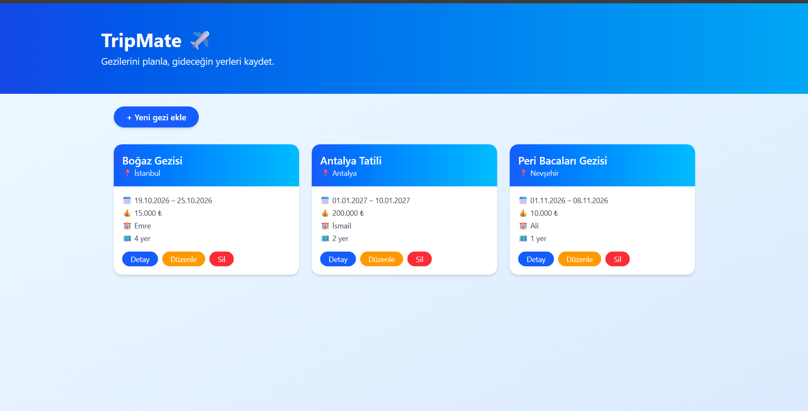
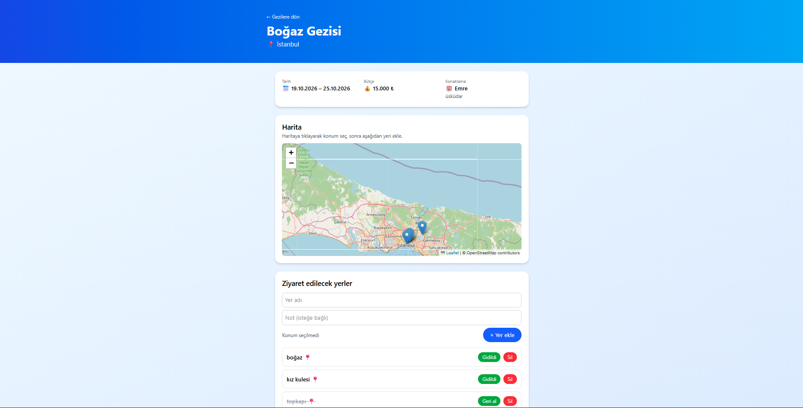
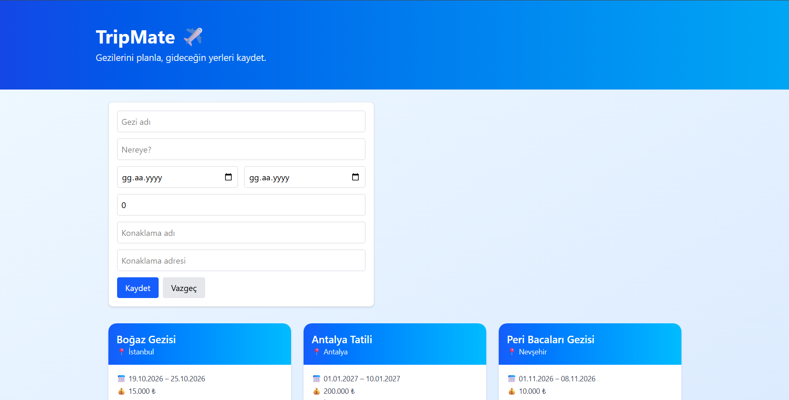

# TripMate

Gezilerini ve ziyaret edeceğin yerleri organize edebileceğin basit bir gezi planlama uygulaması.

## Özellikler

- Gezi ekleme, listeleme, düzenleme ve silme
- Tarih, bütçe ve konaklama bilgisi
- Gezi içine ziyaret edilecek yer ekleme
- Harita üzerinde konum seçme ve gösterme
- Veriler LocalStorage'da saklanır

## Kullanılan Teknolojiler

React, Vite, Tailwind CSS, React Router, Leaflet

## Kurulum

npm install
npm run dev

## Ekran Görüntüleri

